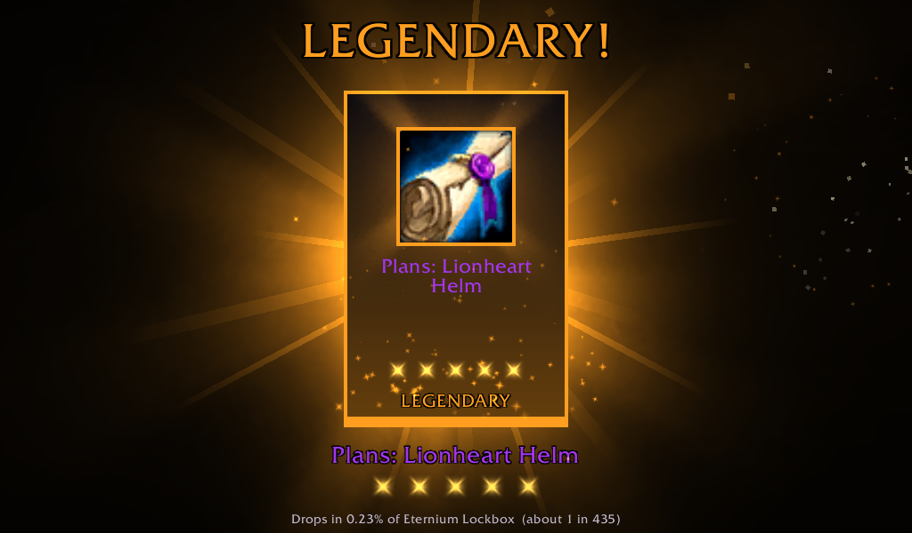
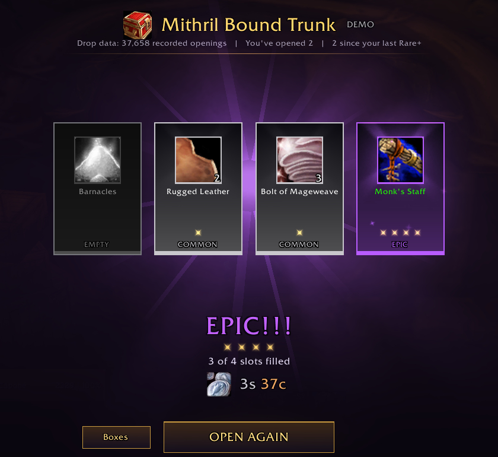
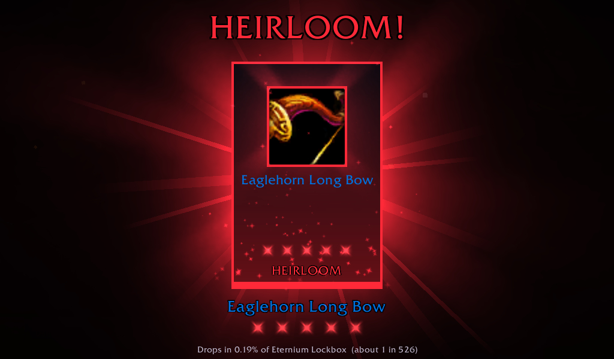
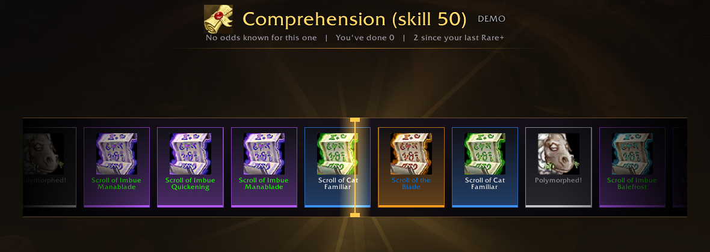
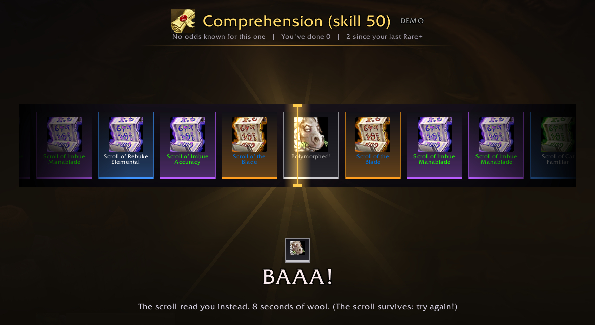
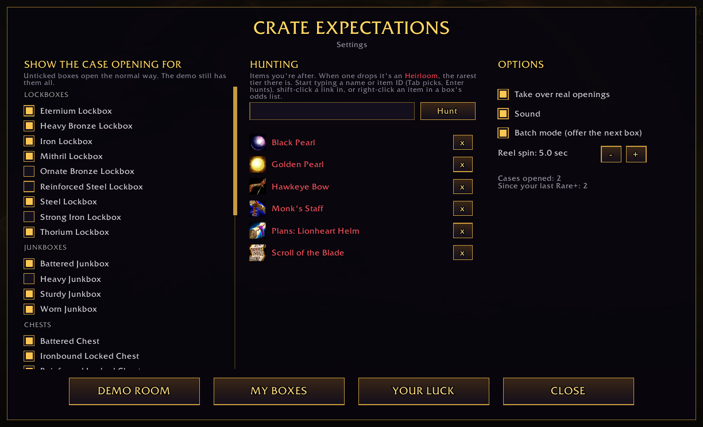

# Crate Expectations

**Every box is a case opening. What did you expect?**

A World of Warcraft addon (WoW Forever) that turns opening lockboxes, junkboxes, fishing trunks, clams, chests and mage scrolls into a full case-opening show. Cards flip, reels spin, embers drift, and the rarer the pull, the bigger the moment.

The show is purely for fun: **your loot is exactly what the game gave you**. The addon only decides how it's revealed.

## What it does

- **Card pulls** for boxes with several items: every item lands as a card, and you flip them one by one.
- **A spinning reel** for boxes that give a single item, landing on what you actually got.
- **Rarity tiers** from Common to Legendary, hand-picked for every item in every supported box.
- **Effects that scale with rarity.** Commons stay quiet, Rares sparkle, Epics glow, and Legendaries take centre stage with the screen dimmed around them.
- **Coin purse** for any gold, silver and copper inside.

## Special tiers

- **Heirloom (red):** add items to your **hunting list** and they always land as Heirloom, the rarest tier in the addon.
- **Elusive (teal):** an item that isn't on our loot list for that box. The addon asks you to report it so it can be added.

## Mage Comprehension

Comprehending an untranslated scroll spins the reel while you cast and lands on the scroll you get. The scroll's Comprehension level decides the pool.

<!-- GIF of a comprehend goes here -->

And yes, if it turns you into a sheep, the reel knows.

## Opening a stack

With **batch mode** (on by default), an **OPEN ANOTHER** button appears after each opening, so you can work through a stack of boxes or scrolls without closing the screen.

## Your Luck

`/crates stats` shows how many boxes you've opened, every tier you've pulled, your best pull ever, and a **luck meter** comparing your Rares and Epics to the average for the exact boxes you opened.

## Settings

`/crates` opens Settings, where you can turn the show off for individual boxes, manage your hunting list, open the **Demo room** to play any box without using one, and open your boxes from **My boxes**.

## Install

Download the latest release and unzip it into `World of Warcraft/_forever_/Interface/AddOns/`, so you end up with `AddOns/CrateExpectationsCases/CrateExpectationsCases.toc`.

Then type `/crates` in game.

## Commands

| Command | What it does |
|---|---|
| `/crates` | Opens Settings |
| `/crates demo` | Plays a demo case (no box used) |
| `/crates <box name>` | Demos a specific box, e.g. `/crates mithril bound` |
| `/crates boxes` | Opens My boxes, to open the boxes in your bags one after another |
| `/crates stats` | Opens Your Luck |
| `/crates debug` | Prints what the addon detects, for bug reports |

`/cases` works too.

## Good to know

- **Auto-loot:** while a box is opening, the addon briefly switches the game's auto-loot setting off so the loot waits for the show. It switches back on automatically.
- **Loot addons:** SpeedyAutoLoot and similar addons are supported. If one grabs the loot first, the show still plays, with everything already in your bags.
- **Skipping the show:** hold your auto-loot modifier key while opening a box.
- **Full bags:** you get a warning, and the loot window comes back so nothing is lost.
- **Combat:** the show closes itself the moment you enter combat.

## Reporting

Found an Elusive item, or a bug? Please [open an issue](https://github.com/L33T/CrateExpectations/issues). For bugs, turn on `/crates debug` before reproducing the problem and include what it prints.

## Credits

Drop chances come from [Wowhead](https://www.wowhead.com/). Item rarities were hand-picked for each box, using vendor and Auction House prices as a guide.

## Disclaimer

This addon was written with heavy help from AI. It's meant as a fun, whimsical way to open your loot, not a serious tool, so please don't take the luck meter too personally. Bugs and odd moments can happen. If you hit one, a report helps make it better.

## License

[MIT](LICENSE). The Crate Expectations name and logo are not covered by the license.
